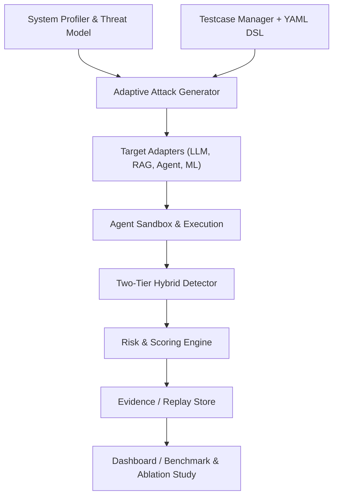

# 🛡️ AI Security TestKit - Bộ Công Cụ Đánh Giá và Kiểm Thử An Toàn Hệ Thống Trí Tuệ Nhân Tạo (Đa Tầng)

> **Đề tài Nghiên cứu Khoa học (NCKH)**: *Phân Tích, Thiết Kế và Phát Triển Bộ Công Cụ Kiểm Thử An Toàn Cho Các Hệ Thống AI*
> **Tiêu chuẩn học thuật**: Chuẩn hóa theo **OWASP Top 10 for LLM Applications 2025** và **MITRE ATLAS**.

---

## 📌 1. Giới Thiệu Tổng Quan

AI Security TestKit là bộ công cụ kiểm thử an toàn đa tầng (Multi-tier Security Testing) tiên tiến dành cho toàn bộ ngăn xếp AI, từ Mô hình Ngôn ngữ Lớn (LLM), ứng dụng Retrieval-Augmented Generation (RAG), hệ thống Tác tử AI (AI Agents), đến các mô hình Học máy (ML/DL) truyền thống. 

Khác với các công cụ chỉ tập trung vào một thành phần đơn lẻ, hệ thống này tích hợp mô hình hóa đe dọa (Threat Modeling), sinh ca kiểm thử thích nghi (Adaptive Test Generation), và đánh giá định lượng rủi ro theo tiêu chuẩn quốc tế.

---

## ✨ 2. Các Đóng Góp và Tính Năng Nổi Bật (Giải Quyết 10 Khoảng Trống Nghiên Cứu)

Hệ thống đã hoàn thiện 100% các yêu cầu kiến trúc nâng cao:

1. **Kiểm Thử Đa Tầng (LLM - RAG - Agent - ML/DL)**: Cover 8/10 OWASP LLM Top 10, mở rộng tấn công cho Agent (Tool Abuse) và mô hình ML (Adversarial Robustness).
2. **Sinh Testcase Thích Nghi (Adaptive Generator)**: Cơ chế sinh payload đột biến có phản hồi (feedback-loop), học từ response của mục tiêu để chọn chiến lược tấn công tiếp theo.
3. **Mô Hình Hóa Đe Dọa (Threat Profiler)**: Tự động phân tích kiến trúc hệ thống mục tiêu và ánh xạ sang MITRE ATLAS.
4. **Agent Sandbox & Mock Tools**: Môi trường hộp cát mô phỏng hành vi Agent để kiểm thử an toàn công cụ mà không gây rủi ro cho hệ thống thật.
5. **Đánh Giá Định Lượng (Extended Metrics)**: Cung cấp ASR, Retrieval Manipulation Rate, Tool Abuse Rate và tính toán khoảng tin cậy.
6. **Thực Nghiệm Bóc Tách (Ablation Study)**: Đánh giá độc lập sự đóng góp của từng thành phần (Mutation Engine, Detector, LLM-Judge) vào độ chính xác tổng thể.
7. **Lưu Trữ Bằng Chứng & Tái Lập (Evidence Replay Store)**: Đảm bảo mọi lỗ hổng đều có thể được truy vết và chạy lại với cấu hình chính xác.
8. **Test DSL & Schema**: Quản lý tập ca kiểm thử bằng YAML/JSON dễ mở rộng.
9. **Bộ Benchmark Tiếng Việt Chuyên Sâu**: Bộ dữ liệu gồm 62 test cases tiếng Việt bao quát các ngữ cảnh ngân hàng, y tế và pháp lý.
10. **Tích Hợp Liên Minh Mã Nguồn Mở**: Hỗ trợ NVIDIA Garak, Microsoft PyRIT, Promptfoo, Giskard, DeepTeam và Adversarial Robustness Toolbox (ART).

---

## 🏛️ 3. Kiến Trúc Hệ Thống (System Architecture)

Sơ đồ kiến trúc dạng Plugin cho phép mở rộng dễ dàng:



---

## 🚀 4. Cài Đặt và Chuẩn Bị Môi Trường

### 4.1 Yêu Cầu Hệ Thống
- Python 3.10+
- Khuyến nghị: **Ollama** cài đặt cục bộ tại `http://localhost:11434`

### 4.2 Cài Đặt Core
```bash
# 1. Clone và tạo môi trường ảo
python -m venv venv
.\venv\Scripts\Activate.ps1   # Windows
source venv/bin/activate       # Linux/Mac

# 2. Cài đặt các thư viện lõi
pip install -r requirements.txt

# 3. Cài đặt các công cụ tích hợp (Optional)
pip install garak pyrit promptfoo deepteam giskard adversarial-robustness-toolbox
```

---

## 💻 5. Hướng Dẫn Sử Dụng Nâng Cao

### 5.1 Quét Đánh Giá Tiêu Chuẩn
```bash
# Khởi động CLI scanner
python main.py
```

### 5.2 Khung Thực Nghiệm Bóc Tách (Ablation Study)
Kiểm chứng đóng góp của các module vào hiệu suất chung:
```bash
# Chạy đánh giá toàn diện các tổ hợp
python experiments/ablation_study.py --mode full

# Bỏ qua module sinh payload thích nghi
python experiments/ablation_study.py --mode single --component ADAPTIVE_GENERATOR
```

### 5.3 Chạy Thực Nghiệm Với Bộ Dữ Liệu Tiếng Việt
```bash
# Sử dụng Vietnamese Benchmark
python experiments/benchmark.py --vietnamese --mode offline
```

### 5.4 Benchmark Đa Mô Hình (Cross-Model Evaluation)
```bash
# Chạy đối chuẩn định lượng trên nhiều model cùng lúc
python experiments/benchmark.py --mode cross --models llama3,mistral,qwen:7b
```

---

## 📁 6. Cấu Trúc Thư Mục Nâng Cấp

```text
AI_Security_Scanner/
├── core/
│   ├── threat_model.py             # Mô hình hóa bề mặt tấn công
│   ├── adaptive_generator.py       # Engine sinh payload thích nghi
│   ├── agent_sandbox.py            # Hộp cát công cụ giả lập cho Agent
│   ├── testcase_loader.py          # YAML DSL parser
│   ├── evidence_store.py           # Lưu trữ và phát lại bằng chứng
│   ├── metrics_extended.py         # Đo lường rủi ro RAG/Agent chuyên biệt
│   └── ...
├── data/
│   ├── testcases/                  # Thư viện kịch bản tấn công (YAML)
│   ├── vietnamese_benchmark.json   # 62 ca kiểm thử ngữ cảnh Việt Nam
│   └── ...
├── experiments/
│   ├── ablation_study.py           # Khung kiểm chứng thực nghiệm
│   └── benchmark.py                # Đo lường hiệu suất
├── modules/
│   ├── exploits/                   # Các chiến thuật (LLM, RAG, Agent, ML)
│   └── integrations/               # Wrappers (Garak, PyRIT, Promptfoo, ART, ...)
└── ...
```

---

## 📚 7. Định Hướng và Bản Quyền

- **Mục đích**: Mã nguồn phục vụ minh chứng cho định hướng nghiên cứu đề xuất. Thích hợp để triển khai thực nghiệm, viết bài báo khoa học chuẩn quốc tế (Q1/Q2).
- **Giấy phép**: Phục vụ học thuật, phi thương mại.
