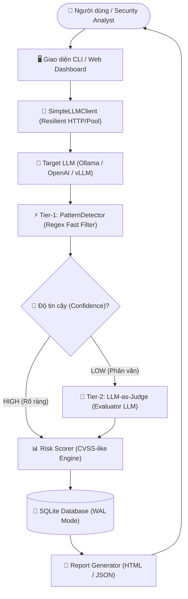

# 🛡️ AI Security Scanner - Bộ Công Cụ Đánh Giá và Kiểm Thử An Toàn Hệ Thống Trí Tuệ Nhân Tạo

> **Đề tài Nghiên cứu Khoa học (NCKH)**: *Nghiên cứu, Thiết kế và Phát triển Bộ Công Cụ Đánh Giá Lỗ Hổng và Kiểm Thử An Toàn Cho Các Ứng Dụng Mô Hình Ngôn Ngữ Lớn (LLM) và Tác Tử AI (AI Agents).*  
> **Tiêu chuẩn học thuật**: Chuẩn hóa theo **OWASP Top 10 for LLM Applications (Phiên bản 2025)** và **MITRE ATLAS (Adversarial Threat Landscape for AI Systems)**.

---

## 📌 1. Giới Thiệu Tổng Quan

Cùng với sự bùng nổ của các mô hình ngôn ngữ lớn (Large Language Models - LLM) và các hệ thống tác tử tự hành (AI Agents) trong đời sống kinh tế - xã hội, các hiểm họa bảo mật mới mang tính chất phi truyền thống ngày càng gia tăng. Khác với phần mềm truyền thống vốn có mã lệnh xác định, LLM vận hành dựa trên các phân phối xác suất và giao tiếp bằng ngôn ngữ tự nhiên, khiến các hàng rào bảo mật kinh điển (như WAF hay kiểm tra cú pháp thông thường) trở nên vô hiệu trước các kỹ thuật tấn công phi kỹ thuật (social engineering on AI), tiêm nhiễm chỉ dẫn (prompt injection), và bẻ khóa an toàn (jailbreak).

**AI Security Scanner** là bộ giải pháp toàn diện phục vụ công tác kiểm thử đối kháng (red-teaming), phát hiện lỗ hổng và đánh giá rủi ro an toàn cho các ứng dụng AI. Hệ thống cung cấp cơ chế kiểm thử hộp đen tự động hóa, bộ phát hiện hai lớp hiện đại (Two-Tier Hybrid Detection), bảng điều khiển web giám sát thời gian thực (SSE), và bộ tài liệu lý thuyết - thực nghiệm chuẩn mực phục vụ hội đồng bảo vệ khoa học.

---

## ✨ 2. Các Đóng Góp và Tính Năng Nổi Bật

1. **Chuẩn hóa Phân loại Lỗ hổng Quốc tế (Taxonomy 2025)**: Đồng bộ 100% danh mục lỗ hổng theo chuẩn quốc tế mới nhất **OWASP LLM Top 10 (2025)** và ma trận kỹ thuật **MITRE ATLAS**.
2. **Cơ chế Phát hiện Hai Lớp (Two-Tier Hybrid Detection)**:
   - *Tier-1 (Pattern Matching)*: Bộ lọc biểu thức chính quy (Regex) tốc độ cao ($< 1$ms/payload), phát hiện các chỉ báo vi phạm và phản hồi từ chối an toàn.
   - *Tier-2 (LLM-as-Judge)*: Giám khảo AI độc lập phân tích ngữ nghĩa sâu khi kết quả Tier-1 phân vân, loại bỏ triệt để tỷ lệ báo động giả (False Positives).
3. **Mô hình Định lượng Rủi ro Kiểu CVSS (CVSS-like Risk Engine)**: Tự động tính toán điểm rủi ro từ $0.0$ đến $10.0$ dựa trên Base Score, Exploitability Multiplier và Brevity Bonus.
4. **Bảng Điều Khiển Web Dashboard Thời Gian Thực**:
   - Truyền phát dữ liệu từng mili-giây qua chuẩn **Server-Sent Events (SSE)**.
   - Thanh tiến độ hiển thị phần trăm trực quan (`%`).
   - Tính năng **Hủy Scan tức thời (Instant Abort)** với cơ chế cô lập khóa phiên đơn nhất bằng UUIDv4.
5. **Khung Thực Nghiệm & Đối Chuẩn Khoa Học (Scientific Benchmark Harness)**:
   - Tách biệt tệp dữ liệu kiểm thử độc lập `data/benchmark_dataset.json`.
   - Hỗ trợ đối sánh hiệu năng đa mô hình (`--models llama3,mistral,qwen:7b`).
   - Tích hợp đối chuẩn với 2 công cụ mã nguồn mở hàng đầu thế giới: **NVIDIA Garak** và **Microsoft PyRIT**.
6. **Thực nghiệm Tấn công Gián tiếp trên RAG (Indirect Prompt Injection Demo)**: Minh họa kịch bản tiêm nhiễm vector tri thức độc hại và cơ chế phòng thủ cách ly ngữ cảnh.

---

## 🏛️ 2.1 Kiến Trúc Hệ Thống (System Architecture)

Sơ đồ quy trình phát hiện hai lớp (Two-Tier Hybrid Detection) và chu trình xử lý của AI Security Scanner:



---

## 📊 3. Ma Trận Module Tấn Công & Phân Loại Lỗ Hổng

| Module | Tên Kỹ Thuật | Mã OWASP (2025) | Mã MITRE ATLAS | Mức Độ | Payloads |
| :--- | :--- | :---: | :---: | :---: | :---: |
| `prompt_injection` | Prompt Injection (Direct & Indirect) | **LLM01** | AML.T0051 | HIGH | 12 |
| `jailbreak` | Jailbreak / Safety Bypass (DAN, AIM, STAN) | **LLM01** | AML.T0054 | CRITICAL | 6 |
| `sensitive_disclosure` | Sensitive Information Disclosure | **LLM02** | AML.T0024 | HIGH | 6 |
| `output_handling` | Improper Output Handling (XSS, SQLi, SSRF) | **LLM05** | AML.T0048 | HIGH | 6 |
| `excessive_agency` | Excessive Agency (Thao túng Tool & Hành vi) | **LLM06** | AML.T0048.001 | CRITICAL | 6 |
| `prompt_leak` | System Prompt Disclosure | **LLM07** | AML.T0010 | MEDIUM | 7 |
| `rag_security` | Vector & Embedding Weaknesses (RAG Security) | **LLM08** | AML.T0020 | HIGH | 6 (+ Demo) |
| `misinformation` | Misinformation / Hallucination Probing | **LLM09** | AML.T0048.003 | MEDIUM | 6 |
| `model_dos` | Unbounded Consumption (Inference DoS) | **LLM10** | AML.T0029 | MEDIUM | 4 |
| `port_scan` | AI Service Port Scanner (Hạ tầng mạng) | Phụ trợ | AML.T0008 | INFO | 6 |

> **Phạm vi Nghiên cứu & Giới hạn Có Chủ ý (Scope & Deliberate Exclusions):**  
> - **OWASP LLM03 (Training Data Poisoning):** Được phân tích chuyên sâu về mặt lý thuyết trong Chương 1, nhưng không thiết kế exploit module thực thi vì đòi hỏi can thiệp trực tiếp vào tập dữ liệu tiền huấn luyện hàng trăm terabyte của nhà cung cấp mô hình (Meta, OpenAI), nằm ngoài phạm vi kiểm thử hộp đen (Black-box API Red-Teaming).  
> - **Đóng gói CI/CD & Docker:** Tập trung giải quyết bài toán cốt lõi về đánh giá lỗ hổng, UI thời gian thực và khung đối chuẩn khoa học; containerization và pipeline CI/CD tự động được quy hoạch trong hướng phát triển tiếp theo.

---

## 🚀 4. Cài Đặt và Chuẩn Bị Môi Trường

### 4.1 Yêu Cầu Hệ Thống
- Hệ điều hành: Windows 10/11, Linux (Ubuntu 20.04+), hoặc macOS.
- Ngôn ngữ: **Python 3.10+** (được kiểm thử toàn diện trên Python 3.11 và 3.13).
- Máy chủ suy luận AI (khuyến nghị): **Ollama** cài đặt cục bộ tại `http://localhost:11434` với các mô hình kiểm thử (`llama3`, `mistral`, `qwen:7b`).

### 4.2 Các Bước Cài Đặt

```bash
# 1. Di chuyển vào thư mục dự án
cd d:/TTCS/NCKH/AI_Security_Scanner

# 2. Tạo và kích hoạt môi trường ảo (Virtual Environment)
python -m venv venv
# Trên Windows PowerShell:
.\venv\Scripts\Activate.ps1
# Trên Linux/macOS:
source venv/bin/activate

# 3. Cài đặt các thư viện lõi của hệ thống
pip install -r requirements.txt

# 4. (Tùy chọn) Cài đặt các công cụ đối chuẩn quốc tế (NVIDIA Garak & Microsoft PyRIT)
pip install garak pyrit
```

---

## 💻 5. Hướng Dẫn Sử Dụng

### 5.1 Sử Dụng Giao Diện Dòng Lệnh (CLI Interface)
Giao diện dòng lệnh tương tác mạnh mẽ với bảng biểu Rich Console:

```bash
# Khởi động CLI scanner
python main.py

# Trong giao diện CLI:
ai-scanner> show modules          # Xem danh sách các module có sẵn
ai-scanner> use prompt_injection  # Chọn module
ai-scanner> set target http://localhost:11434
ai-scanner> set model llama3
ai-scanner> run                   # Thực thi quét module đã chọn
ai-scanner> run all               # Thực thi toàn bộ các module
ai-scanner> report                # Xem bảng tổng hợp báo cáo và lưu DB
```

### 5.2 Sử Dụng Bảng Điều Khiển Web Dashboard
Khởi động máy chủ web Flask với giao diện quản trị hiện đại:

```bash
python web/app.py
```
- Mở trình duyệt tại địa chỉ: **`http://localhost:5000`**
- Tính năng trên Web:
  * Chọn từng module hoặc quét toàn bộ hệ thống (**⚡ Quét Toàn Bộ**).
  * Theo dõi tiến độ quét theo thời gian thực (hiển thị phần trăm `%` và tiến độ từng payload).
  * Nút **⏹️ Hủy Scan** cho phép hủy tiến trình quét ngay tức khắc mà không bị treo server.
  * Xem báo cáo rủi ro trực quan và xuất file báo cáo HTML/JSON.

### 5.3 Chạy Thực Nghiệm Định Lượng (Benchmark Framework)
Chạy bộ đánh giá đối chuẩn độc lập bằng tệp dataset chuẩn hóa:

```bash
# Chế độ Offline (sử dụng ground-truth dataset độc lập):
python experiments/benchmark.py --mode offline

# Chế độ Đánh giá Đa Mô hình (Multi-model Benchmark Leaderboard):
python experiments/benchmark.py --mode offline --models llama3,mistral,qwen:7b

# Chế độ Đối chuẩn Định lượng với Microsoft PyRIT:
python experiments/benchmark.py --mode compare --pyrit-compare

# Chế độ Live (gọi trực tiếp mô hình AI thật đang chạy qua Ollama):
python experiments/benchmark.py --mode live --url http://localhost:11434 --model llama3
```

### 5.4 Chạy Demo Bảo Mật Pipeline RAG (Indirect Prompt Injection)
Minh họa trực quan kịch bản tấn công gián tiếp qua cơ sở dữ liệu tri thức nội bộ và cơ chế bảo vệ:

```bash
python experiments/rag_security_demo.py
```

---

## 📁 6. Cấu Trúc Thư Mục Dự Án

```text
AI_Security_Scanner/
│
├── core/                           # Tầng lõi kiến trúc hệ thống
│   ├── db.py                       # Quản lý CSDL SQLite (scans, findings)
│   ├── llm_client.py               # Kết nối HTTP REST tới LLM (Ollama/OpenAI)
│   ├── owasp_mapper.py             # Ánh xạ mã OWASP 2025 và hướng dẫn khắc phục
│   ├── report.py                   # Xuất báo cáo đa định dạng (HTML, Markdown, JSON)
│   └── risk_scorer.py              # Động cơ tính điểm rủi ro CVSS-like
│
├── data/                           # Dữ liệu phân loại và dataset chuẩn
│   ├── benchmark_dataset.json      # Dataset 32+ ca kiểm thử có nhãn mặt đất (Ground Truth)
│   └── taxonomy.json               # Siêu dữ liệu phân loại OWASP 2025 & MITRE ATLAS
│
├── docs/                           # Trọn bộ tài liệu khoa học phục vụ nghiệm thu
│   ├── theory.md                   # Chương 1: Tổng Quan Lý Thuyết & Tiêu Chuẩn An Toàn AI
│   ├── chapter2_taxonomy.md        # Chương 2: Phân Loại Lỗ Hổng & Mô Hình Đánh Giá Rủi Ro
│   ├── chapter3_methodology.md     # Chương 3: Phương Pháp Kiểm Thử An Toàn AI Hai Lớp
│   ├── chapter4_architecture.md    # Chương 4: Thiết Kế Kiến Trúc Hệ Thống & Cơ Chế Thực Thi
│   ├── chapter5_integration.md     # Chương 5: Tích Hợp Công Cụ Mã Nguồn Mở & Khung Đối Chuẩn
│   └── experiment_results.md       # Chương 6: Thực Nghiệm, Kiểm Chứng và Đánh Giá
│
├── experiments/                    # Thư mục thực nghiệm và đối chuẩn
│   ├── benchmark.py                # Mã nguồn thực nghiệm tính Precision, Recall, F1
│   ├── rag_security_demo.py        # Demo tấn công gián tiếp & phòng vệ trên pipeline RAG
│   └── results/                    # Tệp JSON lưu trữ kết quả benchmark các lần chạy
│
├── modules/                        # Tầng module tấn công và dò quét
│   ├── auxiliary/scanner/          # Quét cổng hạ tầng dịch vụ AI (AML.T0008)
│   ├── detectors/                  # Bộ phát hiện 2 lớp (PatternMatch + LLMJudge)
│   ├── exploits/                   # 8 module khai thác kiểm thử (LLM01 -> LLM10)
│   └── integrations/               # Wrappers tích hợp NVIDIA Garak & Microsoft PyRIT
│
├── web/                            # Ứng dụng Web Dashboard
│   ├── app.py                      # Flask Server hỗ trợ SSE Streaming và Single-Scan Lock
│   ├── static/                     # Tệp CSS và hình ảnh logo
│   └── templates/                  # Giao diện HTML5 responsive
│
├── main.py                         # Điểm vào chính cho giao diện dòng lệnh (CLI)
├── requirements.txt                # Danh sách thư viện phụ thuộc
├── scanner.db                      # Cơ sở dữ liệu SQLite lưu trữ kết quả quét
└── README.md                       # Tài liệu hướng dẫn dự án (tệp này)
```

---

## 📚 7. Tài Liệu Tham Khảo Chính (Academic References)

1. **OWASP Foundation** (2025). *OWASP Top 10 for Large Language Model Applications (v2.0 - 2025)*. [https://owasp.org/www-project-top-10-for-large-language-model-applications/](https://owasp.org/www-project-top-10-for-large-language-model-applications/)
2. **MITRE Corporation** (2024). *Adversarial Threat Landscape for Artificial-Intelligence Systems (MITRE ATLAS)*. [https://atlas.mitre.org/](https://atlas.mitre.org/)
3. **NIST** (2023). *Artificial Intelligence Risk Management Framework (AI RMF 1.0)*. NIST Special Publication.
4. **Zheng, L. et al.** (2023). *Judging LLM-as-a-Judge with MT-Bench and Chatbot Arena*. Advances in Neural Information Processing Systems (NeurIPS 2023).
5. **NVIDIA** (2023-2025). *Garak: Generative AI Red-teaming Architecture*. [https://github.com/leondz/garak](https://github.com/leondz/garak)
6. **Microsoft AI Red Team** (2024). *PyRIT: The Python Risk Identification Tool for generative AI*. [https://github.com/Azure/PyRIT](https://github.com/Azure/PyRIT)

---

## 🎓 8. Thông Tin Đề Tài & Bản Quyền

- **Đơn vị thực hiện**: Nhóm nghiên cứu An toàn Hệ thống Thông tin & AI Security.
- **Mục đích**: Nghiên cứu khoa học sinh viên / Đề tài cấp cơ sở (NCKH).
- **Giấy phép**: Tài liệu và mã nguồn phục vụ mục đích nghiên cứu, học thuật và phi thương mại.
