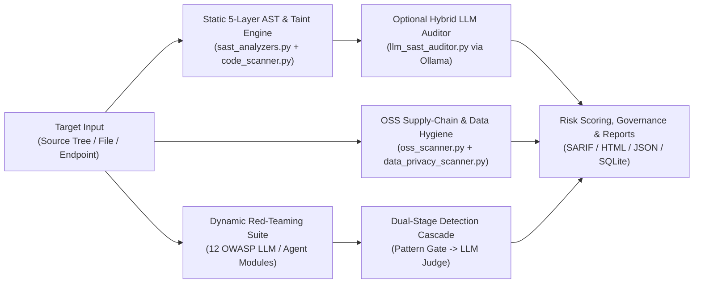

# AI Security Scanner

[](https://www.python.org/)
[-orange.svg)](https://owasp.org/www-project-top-10-for-large-language-model-applications/)
[](https://atlas.mitre.org/)
[](LICENSE)

**`AI_Security_Scanner`** is a Python static and hybrid security analysis toolkit for LLM-powered applications, RAG pipelines, and tool-using AI agents. It combines a **5-layer Python AST taint-tracking & multi-format SAST engine** with **optional local-LLM semantic auditing**, **AI supply-chain/SCA inspection**, **dynamic OWASP LLM Top 10 red-teaming**, and a **hardened runtime Guard Proxy** to detect prompt injection paths, insecure output handling, tainted tool-calling flows, hardcoded AI secrets, and unsafe model deserialization.

---

## Key Features & Scanning Pipeline



### 1. Static AST Taint-Tracking & Hybrid SAST (`modules/auxiliary/scanner/`)
- **5-Layer Python AST Analyzer (`sast_analyzers.py`):**
  - **Layer 1 — Constant Folding & Static De-obfuscation:** Resolves string concatenations, booleans, XOR expressions, Base64, and Hex literals statically without ever calling `eval()` or `exec()` on scanned code.
  - **Layer 2 — Symbolic Aliasing & Unpacking:** Tracks variable aliases, dynamic import loaders, and `**kwargs` dictionary unpacking.
  - **Layer 3 — AI & Runtime Sinks:** Detects direct prompt string interpolation (`f-string` / `.format()` / concatenation into LLM prompts), unsafe code execution (`eval`, `exec`, `compile` + `FunctionType`, `subprocess`, `PythonREPLTool`), unsafe model deserialization (`pickle`, `dill`, `joblib`, `torch.load` without `weights_only=True`), SSRF and missing timeouts (`requests`, `urllib`, `aiohttp`), and Vector DB filter injection.
  - **Layer 4 — Intra-Procedural Taint & Sanitizers:** Tracks tainted parameters, class attributes (`self.<attr>`), and decorator sinks while recognizing sanitizers (`int`, `float`, `bool`, `shlex.quote`, `ast.literal_eval`, `bleach.clean`, `html.escape`, `urllib.parse.quote`).
  - **Layer 5 — Cross-File Taint Propagation (`CrossFileTaintAnalyzer`):** Propagates taint across imported project modules via fixed-point iteration (up to 4 passes) with alias/relative-import resolution and circular-import guards.
- **Multi-Format Analyzers:** YAML anchor/alias inspection (`yaml.safe_load()`), Ollama `Modelfile` directive parsing (`FROM`, `PARAMETER`, `SYSTEM`), and JavaScript/TypeScript static pattern analysis (`Array.join` folding, `new Function`, tagged-template prompt injection).
- **10 AI-Specific SAST Rules (`code_scanner.py`):** `AI-SAST-001` through `AI-SAST-010` mapped to **OWASP LLM Top 10 (2025)**, **MITRE ATLAS**, and **CWE**, with optional Bandit integration and optional Ollama-backed semantic verification (`llm_sast_auditor.py`).

### 2. OSS Supply-Chain, Dataset Hygiene & ML Privacy
- **Open-Source AI Supply-Chain Auditor (`oss_scanner.py`):** SemVer vulnerability checks on AI/ML dependencies (`requirements.txt`), HuggingFace `config.json` `auto_map` / `trust_remote_code` detection, and streaming malicious Pickle opcode scanning for `.pkl`/`.pt`/`.pth`/`.bin` checkpoints (with bounded reads and ZIP-bomb guards).
- **Data Hygiene & ML Privacy (`data_privacy_scanner.py`):** Pre-ingestion dataset auditing (`DATA-001`..`DATA-004` for PII/secrets, indirect injection triggers, duplicate/class skew, SHA-256 provenance) and tabular ML privacy audits (`ML-001` Membership Inference, `ML-002` Black-Box Model Extraction).

### 3. Dynamic Red-Teaming, Governance & Hardened Guard Proxy
- **Modular Exploit & Auxiliary Registry (`modules/registry.py`):** 16 registered modules covering Prompt Injection, Jailbreak, Multi-Turn Jailbreak, System Prompt Leakage, AI Agent Sandbox Testing, Excessive Agency, RAG/Vector Security, Improper Output Handling, Sensitive Disclosure, Misinformation, Unbounded Consumption (DoS), ML Adversarial Robustness, Model Fingerprinting, Port Scanning, SAST, and OSS Supply Chain.
- **Dual-Stage Detection Cascade (`modules/detectors/`):** Deterministic pattern/refusal gating (`pattern_match.py`) paired with an LLM-as-a-Judge verifier (`llm_judge.py`) featuring XML delimiter-breakout escaping.
- **Web Dashboard & REST API (`web/`):** Modular Flask app (`web/app.py` + Blueprints in `web/routes/{reports,sast_oss,governance}.py`), multi-subscriber SSE streaming (`web/services/scan_manager.py`), OpenAPI 3.0.3 Swagger UI (`/api/docs`), JWT/API-Key authentication, server-enforced Rules of Engagement (RoE), SSRF/IPv6 URL filtering (`core/url_security.py`), path confinement (`core/path_security.py`), strict CSP (`script-src-elem 'self'`), and SARIF/HTML/JSON reporting.
- **Hardened AI Guard Proxy v3.1 (`guard_proxy/`):** Standalone Ollama/OpenAI-compatible reverse proxy (`guard_proxy/app.py` + `guard_proxy/Modelfile`) implementing Stage-0 Unicode NFC canonicalization, forged `assistant`-turn inspection, recursive encoding decoders, and canary/PII output filtering.

---

## Project Structure

```text
NCKH/
├── .github/
│   └── workflows/
│       └── ci.yml                  # GitHub Actions workflow (pytest, flake8, bandit, Docker build)
├── .gitignore
├── LICENSE                         # MIT License
├── README.md                       # Project documentation
├── paper/                          # LaTeX research manuscript, generated tables & figures
├── scripts/                        # Reproducible research & benchmark analysis scripts
└── AI_Security_Scanner/            # Core application package (Single Source of Truth)
    ├── main.py                     # CLI entry point (--sast, --oss, --list-modules, or interactive REPL)
    ├── config.yaml                 # Default local configuration (overridable via env / .env)
    ├── .env.example                # Example environment variables for Scanner & Guard Proxy
    ├── requirements.txt            # Core runtime dependencies
    ├── requirements-optional.txt   # Optional ML / third-party red-teaming integrations
    ├── requirements-dev.txt        # Testing, linting & security static analysis tools
    ├── pyproject.toml              # Package metadata & tool configuration
    ├── Dockerfile                  # Container image definition
    ├── docker-compose.yml          # Multi-service orchestration (ai-scanner + ai-guard-proxy)
    ├── gunicorn.conf.py            # Production WSGI server configuration
    ├── core/                       # Engine, LLM client, SQLite DB, path/URL security, governance, stats, reports
    ├── modules/
    │   ├── registry.py             # Unified module metadata & dynamic payload loader
    │   ├── exploits/               # Dynamic OWASP LLM & AI Agent attack modules
    │   ├── detectors/              # Pattern fast-gate & LLM-as-a-Judge cascade
    │   ├── auxiliary/scanner/      # AST taint SAST, Hybrid LLM SAST, OSS SCA, Data/ML Privacy
    │   └── integrations/           # Optional wrappers (Trivy, Garak, Promptfoo, PyRIT, DeepTeam, ART, Giskard)
    ├── web/
    │   ├── app.py                  # Flask application factory & core scan/auth endpoints
    │   ├── security.py             # JWT/API-key auth, rate limiter, CSP headers, RoE & input validation
    │   ├── openapi.py              # OpenAPI 3.0.3 schema & Swagger UI route
    │   ├── routes/                 # Modular Blueprints (reports.py, sast_oss.py, governance.py)
    │   ├── services/               # Multi-subscriber SSE broadcaster & scan orchestration
    │   ├── templates/              # Web Dashboard HTML template (zero inline scripts)
    │   └── static/                 # Externalized JS modules, CSS & localization
    ├── guard_proxy/                # Hardened AI Guard Proxy v3.1 (app.py + Modelfile)
    ├── data/                       # Testcases (YAML DSL), benchmarks & bundled vulnerable sample app
    ├── experiments/                # Evaluation harnesses (benchmark, ablation, multi-seed, judge validation)
    ├── annotations/                # Human validation sheets & double-blind annotation templates
    ├── scripts/                    # Dataset & SSL utility helpers
    └── tests/                      # Unit, security, concurrency, integration & LaTeX integrity tests
```

---

## Quickstart

### Prerequisites
- **Python 3.10+** (verified on Python 3.13)
- *(Optional)* **Ollama** running locally on `http://localhost:11434` (or an OpenAI-compatible API endpoint) for dynamic LLM red-teaming and `--hybrid` LLM SAST auditing. Static AST SAST (`--sast`) and OSS Supply-Chain (`--oss`) scans run completely offline.

### 1. Clone & Install

```bash
git clone https://github.com/HoangHuuPhong39/NCKH.git
cd NCKH/AI_Security_Scanner
```

Create and activate a virtual environment:

```bash
# Linux / macOS
python3 -m venv .venv
source .venv/bin/activate

# Windows (PowerShell)
python -m venv .venv
.\.venv\Scripts\Activate.ps1
```

Install core runtime dependencies:

```bash
pip install --upgrade pip
pip install -r requirements.txt
```

*(Optional)* Install development/test tools or third-party red-teaming integrations:

```bash
pip install -r requirements-dev.txt
# pip install -r requirements-optional.txt
```

### 2. Configure Environment (Optional for Local Scans, Required for Production Auth / Docker)

```bash
cp .env.example .env
# Windows PowerShell: Copy-Item .env.example .env
```

Edit `.env` to configure `SCANNER_TARGET_URL`, `SCANNER_TARGET_MODEL`, `SCANNER_API_KEY`, or production secrets (`SCANNER_JWT_SECRET`, `SCANNER_ADMIN_API_KEY`) if enabling `SCANNER_REQUIRE_AUTH=true`.

### 3. Run a Scan

**A. One-Shot Static AST Taint-Tracking SAST Scan (Offline, No LLM Required)**

Run the 5-layer AST taint engine against the bundled intentionally vulnerable LLM sample app:

```bash
python main.py --sast data/samples/vulnerable_oss_ai_app --no-external-tools
```

Export findings as JSON or enable Ollama-assisted hybrid semantic auditing:

```bash
python main.py --sast data/samples/vulnerable_oss_ai_app --no-external-tools --json
# python main.py --sast data/samples/vulnerable_oss_ai_app --hybrid
```

**B. Open-Source AI Supply-Chain (SCA & Checkpoint) Scan**

```bash
python main.py --oss data/samples/vulnerable_oss_ai_app
```

**C. Interactive CLI Console (Dynamic Red-Teaming)**

```bash
python main.py --list-modules   # View all registered modules and OWASP/MITRE mappings
python main.py                  # Launch interactive Metasploit-style CLI
```

**D. Web Dashboard & REST API (OpenAPI 3.0.3)**

```bash
python web/app.py
# Dashboard:   http://127.0.0.1:5000
# Swagger UI:  http://127.0.0.1:5000/api/docs
```

**E. Hardened AI Guard Proxy v3.1**

```bash
python -m guard_proxy.app
# Default endpoint: http://127.0.0.1:8000 (health check at /healthz)
```

**F. Run the Automated Test Suite**

```bash
pytest --cov=core --cov=modules --cov=web --cov=guard_proxy
```

---

## Roadmap (v2)

While v1 establishes the core 5-layer AST taint analyzer, dynamic OWASP LLM suite, Guard Proxy v3.1, initial `Dockerfile`/`docker-compose.yml`, GitHub Actions CI, and a 238-test `pytest` suite, the **v2 roadmap** focuses on three major engineering milestones:

1. **Full Dockerization & CI Setup for Reproducible Execution Across Environments**
   - Multi-stage, minimal-footprint production images with pinned dependency hashes and non-root read-only runtime hardening across `ai-scanner` and `ai-guard-proxy`.
   - Expanded GitHub Actions matrix testing across Linux/macOS/Windows and Python 3.10–3.13, plus containerized integration smoke tests.
2. **Expanding the AST Taint-Tracking Rule Engine for Complex Multi-File & Async LLM Wrappers**
   - Full inter-procedural call-graph resolution across multi-module packages, factory helpers, and dynamic dispatch patterns.
   - Native `async`/`await`, streaming generator, and callback taint propagation tailored to LangChain, LlamaIndex, CrewAI, AutoGen, and OpenAI/Anthropic SDK wrappers.
3. **Building an Automated Unit Test Suite & Benchmark Harness to Measure and Reduce False Positives**
   - Curated, ground-truth-labeled corpus of real-world vulnerable and hardened LLM repositories (true-positive and benign-control pairs).
   - Automated precision, recall, F1, and false-positive-rate regression harness integrated into CI to gate every new SAST rule and sanitizer update.

---

## License & Responsible Use

Released under the [MIT License](LICENSE). Use this tool strictly against applications, repositories, and endpoints you own or have explicit written authorization to assess.
